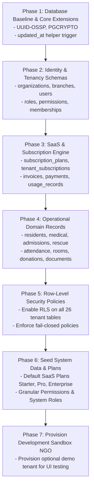

# ElderCare OS — Database Migration & Initial Provisioning Plan

**Document Version:** 3.0.0  
**Status:** Approved Migration Blueprint  
**Architect:** Principal Software Architect & Senior Database Engineer  
**Date:** 23 November 2026  

---

## 1. Migration Overview & Safety Constraints

### 1.1 Core Principles
1. **Zero Data Destruction:** No existing tables are dropped; migrations are purely additive.
2. **Synthetic Data Quarantine:** Existing demo fixtures (e.g. `Ram Prasad`, `Shanti Devi`) in `src/services/fixtures.ts` are strictly synthetic development test fixtures. They must NEVER be treated as real people or merged into production customer databases.
3. **Dynamic Tenant Provisioning:** No NGO (including "Sri Seva Old Age Home") is hardcoded as the sole or permanent first customer. The provisioning process is fully parameterized and dynamic.
4. **Deterministic Rollback:** Every forward migration (`V*.sql`) is paired with an exact rollback script (`U*.sql`).

---

## 2. Phased Migration Execution Sequence



---

## 3. Detailed Migration Steps & SQL Scripts

### Phase 1: Extensions & Base Triggers
File: `migrations/V001__init_extensions.sql`
```sql
CREATE EXTENSION IF NOT EXISTS "uuid-ossp";
CREATE EXTENSION IF NOT EXISTS "pgcrypto";

CREATE OR REPLACE FUNCTION set_updated_at()
RETURNS TRIGGER AS $$
BEGIN
    NEW.updated_at = now();
    RETURN NEW;
END;
$$ LANGUAGE plpgsql;
```

### Phase 2: Identity, Tenancy & Memberships
File: `migrations/V002__identity_and_tenancy.sql`
* Instantiates `organizations`, `branches`, `users`, `roles`, `permissions`, `role_permissions`, `organization_memberships`, `invitations`, `user_sessions`.
* Establishes foreign keys with `ON DELETE CASCADE` on tenant-owned joins.

### Phase 3: SaaS & Subscriptions
File: `migrations/V003__saas_and_subscriptions.sql`
* Instantiates `subscription_plans`, `tenant_subscriptions`, `subscription_invoices`, `subscription_payments`, `payment_webhook_events`, `usage_records`, `platform_audit_logs`.
* Sets up unique indexes for payment idempotency.

### Phase 4: Operational Domain Entities
File: `migrations/V004__operational_domain.sql`
* Instantiates all 19 domain tables (`residents`, `rescue_cases`, `admissions`, `medical_records`, `prescriptions`, `medication_schedules`, `attendance`, `visitors`, `rooms`, `beds`, `documents`, `donations`, `expenses`, `tasks`, `daily_diary`, `events`, `tenant_audit_logs`).

### Phase 5: Row-Level Security
File: `migrations/V005__enable_rls.sql`
* Executes `ALTER TABLE ... ENABLE ROW LEVEL SECURITY;`
* Executes `ALTER TABLE ... FORCE ROW LEVEL SECURITY;`
* Applies `get_current_organization_id()` and `is_platform_admin()` policies.

### Phase 6: System Catalog & Plans Seeding
File: `migrations/V006__seed_system_catalog.sql`
```sql
-- Seed Standard SaaS Plans
INSERT INTO subscription_plans (id, code, name, description, price_monthly_inr, price_annual_inr, max_residents, max_staff_accounts, max_storage_gb, features)
VALUES 
    ('00000000-0000-0000-0000-000000000001', 'starter', 'Starter Care', 'Designed for small community ashrams', 2999.00, 29990.00, 30, 5, 10, '{"custom_forms": false, "ai_ocr": false, "family_portal": true}'::jsonb),
    ('00000000-0000-0000-0000-000000000002', 'pro', 'Professional NGO', 'Comprehensive care for mid-sized homes', 7999.00, 79990.00, 100, 20, 50, '{"custom_forms": true, "ai_ocr": true, "family_portal": true}'::jsonb),
    ('00000000-0000-0000-0000-000000000003', 'enterprise', 'Enterprise Multi-Branch', 'Unlimited capacity for multi-branch organizations', 19999.00, 199990.00, 500, 100, 250, '{"custom_forms": true, "ai_ocr": true, "family_portal": true, "custom_domain": true}'::jsonb)
ON CONFLICT (code) DO NOTHING;

-- Seed Global System Roles
INSERT INTO roles (id, organization_id, name, code, description, is_system)
VALUES
    ('10000000-0000-0000-0000-000000000001', NULL, 'Platform Super Admin', 'platform_super_admin', 'Global operator of ElderCare OS platform', true),
    ('10000000-0000-0000-0000-000000000002', NULL, 'NGO Administrator', 'ngo_admin', 'Complete operational control over single NGO workspace', true),
    ('10000000-0000-0000-0000-000000000003', NULL, 'Doctor', 'doctor', 'Clinical records, prescriptions, and medical vitals', true),
    ('10000000-0000-0000-0000-000000000004', NULL, 'Caretaker / Nurse', 'nurse', 'Daily resident care, attendance, and medication checklist', true),
    ('10000000-0000-0000-0000-000000000005', NULL, 'Accountant', 'accountant', 'Donations, 80G tax receipts, and NGO expenditures', true),
    ('10000000-0000-0000-0000-000000000006', NULL, 'Staff Member', 'staff', 'Assigned general daily operational duties', true),
    ('10000000-0000-0000-0000-000000000007', NULL, 'Volunteer', 'volunteer', 'Recreational activities, visits, and support', true),
    ('10000000-0000-0000-0000-000000000008', NULL, 'Family Member', 'family_guardian', 'Permitted read-only access to linked resident updates', true)
ON CONFLICT (organization_id, code) DO NOTHING;
```

---

## 4. Parameterized Procedure: Provisioning a New Tenant NGO

```sql
-- Dynamic Stored Procedure for Automatic Tenant NGO Provisioning
CREATE OR REPLACE FUNCTION provision_new_ngo_workspace(
    p_org_name VARCHAR,
    p_org_slug VARCHAR,
    p_admin_name VARCHAR,
    p_admin_email VARCHAR,
    p_admin_password_hash TEXT,
    p_plan_code VARCHAR DEFAULT 'starter',
    p_trial_days INT DEFAULT 30
)
RETURNS JSONB AS $$
DECLARE
    v_org_id UUID;
    v_user_id UUID;
    v_plan_id UUID;
    v_role_id UUID;
    v_sub_id UUID;
BEGIN
    -- 1. Validate slug uniqueness
    IF EXISTS (SELECT 1 FROM organizations WHERE slug = p_org_slug) THEN
        RAISE EXCEPTION 'Organization workspace slug "%" is already taken.', p_org_slug;
    END IF;

    -- 2. Lookup subscription plan
    SELECT id INTO v_plan_id FROM subscription_plans WHERE code = p_plan_code;
    IF v_plan_id IS NULL THEN
        RAISE EXCEPTION 'Invalid plan code "%".', p_plan_code;
    END IF;

    -- 3. Lookup NGO Administrator system role
    SELECT id INTO v_role_id FROM roles WHERE code = 'ngo_admin' AND organization_id IS NULL;

    -- 4. Create Organization
    INSERT INTO organizations (name, slug, email)
    VALUES (p_org_name, p_org_slug, p_admin_email)
    RETURNING id INTO v_org_id;

    -- 5. Create default Main Branch
    INSERT INTO branches (organization_id, name, code)
    VALUES (v_org_id, 'Main Ashram Campus', 'MAIN');

    -- 6. Create or link Admin User
    INSERT INTO users (email, display_name, password_hash, email_verified_at)
    VALUES (p_admin_email, p_admin_name, p_admin_password_hash, now())
    ON CONFLICT (email) DO UPDATE SET updated_at = now()
    RETURNING id INTO v_user_id;

    -- 7. Grant NGO Administrator Membership
    INSERT INTO organization_memberships (user_id, organization_id, role_id, is_primary)
    VALUES (v_user_id, v_org_id, v_role_id, true);

    -- 8. Provision Trial Subscription
    INSERT INTO tenant_subscriptions (
        organization_id,
        plan_id,
        status,
        current_period_start,
        current_period_end,
        grace_period_ends_at
    )
    VALUES (
        v_org_id,
        v_plan_id,
        'trial',
        now(),
        now() + (p_trial_days || ' days')::INTERVAL,
        now() + ((p_trial_days + 14) || ' days')::INTERVAL
    )
    RETURNING id INTO v_sub_id;

    -- 9. Initialize Usage Records
    INSERT INTO usage_records (organization_id, metric, quota_limit)
    SELECT v_org_id, 'resident_count', max_residents FROM subscription_plans WHERE id = v_plan_id;

    -- 10. Audit Log the Provisioning Event
    INSERT INTO platform_audit_logs (actor_user_id, action, target_type, target_id, target_organization_id, details)
    VALUES (v_user_id, 'PROVISION_ORGANIZATION', 'organizations', v_org_id, v_org_id, 
            jsonb_build_object('slug', p_org_slug, 'plan', p_plan_code, 'trial_days', p_trial_days));

    RETURN jsonb_build_object(
        'success', true,
        'organization_id', v_org_id,
        'slug', p_org_slug,
        'admin_user_id', v_user_id,
        'subscription_id', v_sub_id
    );
END;
$$ LANGUAGE plpgsql;
```

---

## 5. Rollback Procedures & Verification Checklist

### 5.1 Rollback Sequence
In the event of an unexpected migration failure during deployment:

```sql
-- Rollback V005 (RLS)
DROP POLICY IF EXISTS tenant_isolation_residents ON residents;
-- (repeat for all domain tables)

-- Rollback V004 & V003 (Domain & SaaS tables)
DROP TABLE IF EXISTS tenant_audit_logs, events, daily_diary, tasks, expenses, donations, documents, visits, visitors, beds, rooms, attendance, medication_schedules, prescriptions, medical_observations, medical_records, admissions, rescue_cases, residents CASCADE;
DROP TABLE IF EXISTS platform_audit_logs, usage_records, payment_webhook_events, subscription_payments, subscription_invoices, tenant_subscriptions, subscription_plans CASCADE;

-- Rollback V002 (Identity & Tenancy)
DROP TABLE IF EXISTS user_sessions, invitations, organization_memberships, role_permissions, permissions, roles, users, branches, organizations CASCADE;

-- Rollback V001 (Functions & Enums)
DROP FUNCTION IF EXISTS set_updated_at CASCADE;
DROP TYPE IF EXISTS priority_enum, admission_status_enum, rescue_status_enum, resident_status_enum, subscription_status_enum, org_status_enum, user_status_enum CASCADE;
```

### 5.2 Verification Checklist Post-Migration
- [ ] PostgreSQL version confirmed $\ge 18$.
- [ ] All 36 relational tables present in `information_schema.tables`.
- [ ] RLS enabled on all 26 tenant tables: `SELECT tablename, rowsecurity FROM pg_tables WHERE schemaname = 'public';`.
- [ ] Standard subscription plans present (Starter, Pro, Enterprise).
- [ ] Negative security tests executed and passed (0 rows leaked).
- [ ] Automated test provisioning of trial NGO executed successfully.
