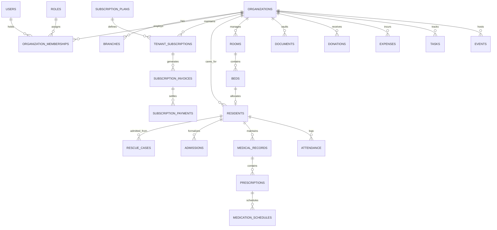

# ElderCare OS — Final Database Schema & DDL Specification

**Database Engine:** PostgreSQL 18  
**Document Version:** 3.0.0  
**Status:** Approved Schema DDL  
**Architect:** Principal Software Architect & Senior Database Engineer  
**Date:** 23 November 2026  

---

## 1. High-Level Entity Relationship Diagram



---

## 2. Complete PostgreSQL 18 Executable DDL

```sql
-- ============================================================================
-- 1. EXTENSIONS & CUSTOM DOMAINS / ENUMS
-- ============================================================================

CREATE EXTENSION IF NOT EXISTS "uuid-ossp";
CREATE EXTENSION IF NOT EXISTS "pgcrypto";

-- Generic triggers for updated_at timestamps
CREATE OR REPLACE FUNCTION set_updated_at()
RETURNS TRIGGER AS $$
BEGIN
    NEW.updated_at = now();
    RETURN NEW;
END;
$$ LANGUAGE plpgsql;

-- Enums
CREATE TYPE user_status_enum AS ENUM ('active', 'invited', 'suspended', 'deactivated');
CREATE TYPE org_status_enum AS ENUM ('active', 'trialing', 'past_due', 'suspended', 'cancelled');
CREATE TYPE subscription_status_enum AS ENUM ('trial', 'active', 'past_due', 'grace_period', 'suspended', 'cancelled');
CREATE TYPE resident_status_enum AS ENUM ('active', 'hospitalized', 'on_leave', 'transferred', 'deceased', 'discharged');
CREATE TYPE rescue_status_enum AS ENUM ('reported', 'in_progress', 'rescued', 'admitted', 'referred', 'closed');
CREATE TYPE admission_status_enum AS ENUM ('submitted', 'under_review', 'medical_clearance', 'approved', 'rejected', 'withdrawn');
CREATE TYPE priority_enum AS ENUM ('low', 'medium', 'high', 'urgent');

-- ============================================================================
-- 2. IDENTITY, TENANCY & MEMBERSHIPS
-- ============================================================================

-- Core Organizations (Tenant Workspaces)
CREATE TABLE organizations (
    id UUID PRIMARY KEY DEFAULT gen_random_uuid(),
    slug VARCHAR(80) UNIQUE NOT NULL,
    name VARCHAR(200) NOT NULL,
    legal_name VARCHAR(250),
    registration_number VARCHAR(120),
    email VARCHAR(254) NOT NULL,
    phone VARCHAR(40),
    website VARCHAR(255),
    address JSONB DEFAULT '{}'::jsonb,
    timezone VARCHAR(80) NOT NULL DEFAULT 'Asia/Kolkata',
    currency CHAR(3) NOT NULL DEFAULT 'INR',
    status org_status_enum NOT NULL DEFAULT 'active',
    settings JSONB DEFAULT '{"allow_family_portal": true, "offline_sync_enabled": true}'::jsonb,
    created_at TIMESTAMPTZ NOT NULL DEFAULT now(),
    updated_at TIMESTAMPTZ NOT NULL DEFAULT now()
);

CREATE INDEX idx_organizations_slug ON organizations(slug);
CREATE TRIGGER trg_organizations_updated_at BEFORE UPDATE ON organizations FOR EACH ROW EXECUTE FUNCTION set_updated_at();

-- NGO Branches
CREATE TABLE branches (
    id UUID PRIMARY KEY DEFAULT gen_random_uuid(),
    organization_id UUID NOT NULL REFERENCES organizations(id) ON DELETE CASCADE,
    name VARCHAR(160) NOT NULL,
    code VARCHAR(40) NOT NULL,
    phone VARCHAR(40),
    address JSONB DEFAULT '{}'::jsonb,
    status VARCHAR(20) NOT NULL DEFAULT 'active',
    created_at TIMESTAMPTZ NOT NULL DEFAULT now(),
    updated_at TIMESTAMPTZ NOT NULL DEFAULT now(),
    UNIQUE(organization_id, code)
);

CREATE INDEX idx_branches_organization_id ON branches(organization_id);

-- Global Users (Universal Identity)
CREATE TABLE users (
    id UUID PRIMARY KEY DEFAULT gen_random_uuid(),
    email VARCHAR(254) UNIQUE NOT NULL,
    phone VARCHAR(40),
    display_name VARCHAR(160) NOT NULL,
    password_hash TEXT NOT NULL,
    is_platform_user BOOLEAN NOT NULL DEFAULT false, -- True ONLY for Platform Super Admins
    avatar_url TEXT,
    email_verified_at TIMESTAMPTZ,
    status user_status_enum NOT NULL DEFAULT 'active',
    last_login_at TIMESTAMPTZ,
    created_at TIMESTAMPTZ NOT NULL DEFAULT now(),
    updated_at TIMESTAMPTZ NOT NULL DEFAULT now()
);

CREATE INDEX idx_users_email ON users(email);
CREATE TRIGGER trg_users_updated_at BEFORE UPDATE ON users FOR EACH ROW EXECUTE FUNCTION set_updated_at();

-- Roles Catalogue
CREATE TABLE roles (
    id UUID PRIMARY KEY DEFAULT gen_random_uuid(),
    organization_id UUID REFERENCES organizations(id) ON DELETE CASCADE, -- NULL for global system roles
    name VARCHAR(80) NOT NULL,
    code VARCHAR(80) NOT NULL,
    description TEXT,
    is_system BOOLEAN NOT NULL DEFAULT false,
    created_at TIMESTAMPTZ NOT NULL DEFAULT now(),
    UNIQUE(organization_id, code)
);

-- Granular Permissions Catalogue
CREATE TABLE permissions (
    id UUID PRIMARY KEY DEFAULT gen_random_uuid(),
    code VARCHAR(120) UNIQUE NOT NULL,
    category VARCHAR(60) NOT NULL,
    description TEXT NOT NULL
);

-- Role-Permission Mapping
CREATE TABLE role_permissions (
    role_id UUID NOT NULL REFERENCES roles(id) ON DELETE CASCADE,
    permission_id UUID NOT NULL REFERENCES permissions(id) ON DELETE CASCADE,
    PRIMARY KEY(role_id, permission_id)
);

-- Organization Memberships (User <-> Tenant Mapping)
CREATE TABLE organization_memberships (
    id UUID PRIMARY KEY DEFAULT gen_random_uuid(),
    user_id UUID NOT NULL REFERENCES users(id) ON DELETE CASCADE,
    organization_id UUID NOT NULL REFERENCES organizations(id) ON DELETE CASCADE,
    branch_id UUID REFERENCES branches(id) ON DELETE SET NULL,
    role_id UUID NOT NULL REFERENCES roles(id),
    status user_status_enum NOT NULL DEFAULT 'active',
    is_primary BOOLEAN NOT NULL DEFAULT false,
    joined_at TIMESTAMPTZ NOT NULL DEFAULT now(),
    UNIQUE(user_id, organization_id)
);

CREATE INDEX idx_org_memberships_user ON organization_memberships(user_id);
CREATE INDEX idx_org_memberships_org ON organization_memberships(organization_id);

-- User Invitations
CREATE TABLE invitations (
    id UUID PRIMARY KEY DEFAULT gen_random_uuid(),
    organization_id UUID NOT NULL REFERENCES organizations(id) ON DELETE CASCADE,
    email VARCHAR(254) NOT NULL,
    role_id UUID NOT NULL REFERENCES roles(id),
    invited_by UUID NOT NULL REFERENCES users(id),
    token_hash TEXT NOT NULL,
    expires_at TIMESTAMPTZ NOT NULL,
    accepted_at TIMESTAMPTZ,
    created_at TIMESTAMPTZ NOT NULL DEFAULT now()
);

CREATE INDEX idx_invitations_token ON invitations(token_hash);

-- User Sessions (Stateful or Refresh Tokens)
CREATE TABLE user_sessions (
    id UUID PRIMARY KEY DEFAULT gen_random_uuid(),
    user_id UUID NOT NULL REFERENCES users(id) ON DELETE CASCADE,
    active_organization_id UUID REFERENCES organizations(id) ON DELETE SET NULL,
    session_token_hash TEXT NOT NULL,
    ip_address INET,
    user_agent TEXT,
    expires_at TIMESTAMPTZ NOT NULL,
    created_at TIMESTAMPTZ NOT NULL DEFAULT now()
);

CREATE INDEX idx_sessions_user_id ON user_sessions(user_id);

-- ============================================================================
-- 3. COMMERCIAL SAAS & SUBSCRIPTION MANAGEMENT
-- ============================================================================

-- Subscription Plans
CREATE TABLE subscription_plans (
    id UUID PRIMARY KEY DEFAULT gen_random_uuid(),
    code VARCHAR(50) UNIQUE NOT NULL, -- 'starter', 'pro', 'enterprise'
    name VARCHAR(100) NOT NULL,
    description TEXT,
    price_monthly_inr NUMERIC(10, 2) NOT NULL,
    price_annual_inr NUMERIC(10, 2) NOT NULL,
    max_residents INT NOT NULL,
    max_staff_accounts INT NOT NULL,
    max_storage_gb INT NOT NULL,
    features JSONB NOT NULL DEFAULT '{}'::jsonb,
    is_active BOOLEAN NOT NULL DEFAULT true,
    created_at TIMESTAMPTZ NOT NULL DEFAULT now(),
    updated_at TIMESTAMPTZ NOT NULL DEFAULT now()
);

-- Tenant Subscriptions
CREATE TABLE tenant_subscriptions (
    id UUID PRIMARY KEY DEFAULT gen_random_uuid(),
    organization_id UUID UNIQUE NOT NULL REFERENCES organizations(id) ON DELETE CASCADE,
    plan_id UUID NOT NULL REFERENCES subscription_plans(id),
    status subscription_status_enum NOT NULL DEFAULT 'trial',
    billing_cycle VARCHAR(20) NOT NULL DEFAULT 'monthly', -- 'monthly', 'annual'
    current_period_start TIMESTAMPTZ NOT NULL DEFAULT now(),
    current_period_end TIMESTAMPTZ NOT NULL,
    grace_period_ends_at TIMESTAMPTZ,
    payment_gateway VARCHAR(40) DEFAULT 'razorpay', -- 'razorpay', 'offline_cheque'
    gateway_subscription_id VARCHAR(200),
    gateway_customer_id VARCHAR(200),
    auto_renew BOOLEAN NOT NULL DEFAULT true,
    cancelled_at TIMESTAMPTZ,
    created_at TIMESTAMPTZ NOT NULL DEFAULT now(),
    updated_at TIMESTAMPTZ NOT NULL DEFAULT now()
);

CREATE INDEX idx_tenant_sub_org ON tenant_subscriptions(organization_id);

-- Subscription Invoices
CREATE TABLE subscription_invoices (
    id UUID PRIMARY KEY DEFAULT gen_random_uuid(),
    organization_id UUID NOT NULL REFERENCES organizations(id) ON DELETE CASCADE,
    subscription_id UUID NOT NULL REFERENCES tenant_subscriptions(id),
    invoice_number VARCHAR(100) UNIQUE NOT NULL,
    amount NUMERIC(10, 2) NOT NULL,
    tax_amount NUMERIC(10, 2) NOT NULL DEFAULT 0.00,
    total_amount NUMERIC(10, 2) NOT NULL,
    currency CHAR(3) NOT NULL DEFAULT 'INR',
    status VARCHAR(30) NOT NULL DEFAULT 'unpaid', -- 'unpaid', 'paid', 'void', 'failed'
    due_date DATE NOT NULL,
    paid_at TIMESTAMPTZ,
    invoice_pdf_url TEXT,
    created_at TIMESTAMPTZ NOT NULL DEFAULT now()
);

CREATE INDEX idx_sub_invoices_org ON subscription_invoices(organization_id);

-- Subscription Payments
CREATE TABLE subscription_payments (
    id UUID PRIMARY KEY DEFAULT gen_random_uuid(),
    organization_id UUID NOT NULL REFERENCES organizations(id) ON DELETE CASCADE,
    invoice_id UUID NOT NULL REFERENCES subscription_invoices(id),
    gateway VARCHAR(40) NOT NULL,
    gateway_payment_id VARCHAR(200) NOT NULL,
    gateway_order_id VARCHAR(200),
    amount NUMERIC(10, 2) NOT NULL,
    status VARCHAR(30) NOT NULL,
    captured_at TIMESTAMPTZ NOT NULL DEFAULT now()
);

-- Payment Webhook Events (Idempotency ledger)
CREATE TABLE payment_webhook_events (
    id UUID PRIMARY KEY DEFAULT gen_random_uuid(),
    gateway VARCHAR(40) NOT NULL,
    event_id VARCHAR(200) UNIQUE NOT NULL,
    event_type VARCHAR(100) NOT NULL,
    payload JSONB NOT NULL,
    processed BOOLEAN NOT NULL DEFAULT false,
    processed_at TIMESTAMPTZ,
    error_message TEXT,
    created_at TIMESTAMPTZ NOT NULL DEFAULT now()
);

-- Usage Quota Records
CREATE TABLE usage_records (
    id UUID PRIMARY KEY DEFAULT gen_random_uuid(),
    organization_id UUID NOT NULL REFERENCES organizations(id) ON DELETE CASCADE,
    metric VARCHAR(60) NOT NULL, -- 'resident_count', 'staff_count', 'storage_bytes'
    current_value BIGINT NOT NULL DEFAULT 0,
    quota_limit BIGINT NOT NULL,
    updated_at TIMESTAMPTZ NOT NULL DEFAULT now(),
    UNIQUE(organization_id, metric)
);

-- Platform Audit Logs (Cross-tenant administrative actions)
CREATE TABLE platform_audit_logs (
    id UUID PRIMARY KEY DEFAULT gen_random_uuid(),
    actor_user_id UUID REFERENCES users(id),
    action VARCHAR(100) NOT NULL,
    target_type VARCHAR(60) NOT NULL,
    target_id UUID,
    target_organization_id UUID REFERENCES organizations(id),
    details JSONB,
    ip_address INET,
    created_at TIMESTAMPTZ NOT NULL DEFAULT now()
);

-- ============================================================================
-- 4. OPERATIONAL NGO DOMAIN RECORDS (TENANT-SCOPED)
-- ============================================================================

-- Residents Master Table
CREATE TABLE residents (
    id UUID PRIMARY KEY DEFAULT gen_random_uuid(),
    organization_id UUID NOT NULL REFERENCES organizations(id) ON DELETE CASCADE,
    branch_id UUID REFERENCES branches(id),
    resident_number VARCHAR(60) NOT NULL,
    full_name VARCHAR(160) NOT NULL,
    date_of_birth DATE,
    age INT,
    gender VARCHAR(20) NOT NULL,
    blood_group VARCHAR(10),
    aadhaar_number_hash VARCHAR(128),
    photo_url TEXT,
    resident_status resident_status_enum NOT NULL DEFAULT 'active',
    primary_condition TEXT,
    notes TEXT,
    created_by UUID REFERENCES users(id),
    created_at TIMESTAMPTZ NOT NULL DEFAULT now(),
    updated_at TIMESTAMPTZ NOT NULL DEFAULT now(),
    UNIQUE(organization_id, resident_number)
);

CREATE INDEX idx_residents_org ON residents(organization_id);
CREATE INDEX idx_residents_status ON residents(organization_id, resident_status);
CREATE TRIGGER trg_residents_updated_at BEFORE UPDATE ON residents FOR EACH ROW EXECUTE FUNCTION set_updated_at();

-- Rescue Cases
CREATE TABLE rescue_cases (
    id UUID PRIMARY KEY DEFAULT gen_random_uuid(),
    organization_id UUID NOT NULL REFERENCES organizations(id) ON DELETE CASCADE,
    branch_id UUID REFERENCES branches(id),
    case_number VARCHAR(60) NOT NULL,
    informant_name VARCHAR(160),
    informant_phone VARCHAR(40),
    rescue_location TEXT NOT NULL,
    geo_point POINT,
    rescued_elder_name VARCHAR(160),
    estimated_age INT,
    gender VARCHAR(20),
    health_condition_summary TEXT,
    case_status rescue_status_enum NOT NULL DEFAULT 'reported',
    police_intimation_done BOOLEAN NOT NULL DEFAULT false,
    police_station_name VARCHAR(160),
    associated_resident_id UUID REFERENCES residents(id),
    created_by UUID REFERENCES users(id),
    created_at TIMESTAMPTZ NOT NULL DEFAULT now(),
    updated_at TIMESTAMPTZ NOT NULL DEFAULT now(),
    UNIQUE(organization_id, case_number)
);

CREATE INDEX idx_rescue_cases_org ON rescue_cases(organization_id);
CREATE TRIGGER trg_rescue_cases_updated_at BEFORE UPDATE ON rescue_cases FOR EACH ROW EXECUTE FUNCTION set_updated_at();

-- Admissions
CREATE TABLE admissions (
    id UUID PRIMARY KEY DEFAULT gen_random_uuid(),
    organization_id UUID NOT NULL REFERENCES organizations(id) ON DELETE CASCADE,
    branch_id UUID REFERENCES branches(id),
    admission_number VARCHAR(60) NOT NULL,
    resident_id UUID REFERENCES residents(id),
    rescue_case_id UUID REFERENCES rescue_cases(id),
    applicant_name VARCHAR(160) NOT NULL,
    intake_source VARCHAR(60) NOT NULL, -- 'direct_walkin', 'rescue', 'hospital_transfer'
    admission_status admission_status_enum NOT NULL DEFAULT 'under_review',
    decision_notes TEXT,
    allocated_room_id UUID,
    allocated_bed_id UUID,
    applied_at TIMESTAMPTZ NOT NULL DEFAULT now(),
    reviewed_by UUID REFERENCES users(id),
    reviewed_at TIMESTAMPTZ,
    created_at TIMESTAMPTZ NOT NULL DEFAULT now(),
    updated_at TIMESTAMPTZ NOT NULL DEFAULT now(),
    UNIQUE(organization_id, admission_number)
);

CREATE INDEX idx_admissions_org ON admissions(organization_id);
CREATE TRIGGER trg_admissions_updated_at BEFORE UPDATE ON admissions FOR EACH ROW EXECUTE FUNCTION set_updated_at();

-- Medical Records
CREATE TABLE medical_records (
    id UUID PRIMARY KEY DEFAULT gen_random_uuid(),
    organization_id UUID NOT NULL REFERENCES organizations(id) ON DELETE CASCADE,
    resident_id UUID NOT NULL REFERENCES residents(id) ON DELETE CASCADE,
    condition_name VARCHAR(160) NOT NULL,
    diagnosed_date DATE,
    severity VARCHAR(30) DEFAULT 'moderate', -- 'mild', 'moderate', 'severe', 'critical'
    notes TEXT,
    is_chronic BOOLEAN NOT NULL DEFAULT false,
    is_active BOOLEAN NOT NULL DEFAULT true,
    created_by UUID REFERENCES users(id),
    created_at TIMESTAMPTZ NOT NULL DEFAULT now(),
    updated_at TIMESTAMPTZ NOT NULL DEFAULT now()
);

CREATE INDEX idx_med_records_resident ON medical_records(organization_id, resident_id);

-- Medical Observations / Vitals
CREATE TABLE medical_observations (
    id UUID PRIMARY KEY DEFAULT gen_random_uuid(),
    organization_id UUID NOT NULL REFERENCES organizations(id) ON DELETE CASCADE,
    resident_id UUID NOT NULL REFERENCES residents(id) ON DELETE CASCADE,
    systolic_bp INT,
    diastolic_bp INT,
    pulse_rate INT,
    blood_glucose_mg_dl NUMERIC(5, 1),
    spo2_percent INT,
    body_temp_f NUMERIC(4, 1),
    recorded_at TIMESTAMPTZ NOT NULL DEFAULT now(),
    recorded_by UUID REFERENCES users(id),
    clinical_notes TEXT
);

CREATE INDEX idx_med_observations_resident ON medical_observations(organization_id, resident_id);

-- Prescriptions
CREATE TABLE prescriptions (
    id UUID PRIMARY KEY DEFAULT gen_random_uuid(),
    organization_id UUID NOT NULL REFERENCES organizations(id) ON DELETE CASCADE,
    resident_id UUID NOT NULL REFERENCES residents(id) ON DELETE CASCADE,
    medication_name VARCHAR(160) NOT NULL,
    dosage VARCHAR(80) NOT NULL,
    frequency VARCHAR(80) NOT NULL, -- 'morning', 'afternoon', 'night', 'sos'
    start_date DATE NOT NULL,
    end_date DATE,
    prescribed_by_doctor_name VARCHAR(160) NOT NULL,
    status VARCHAR(20) NOT NULL DEFAULT 'active',
    instructions TEXT,
    created_at TIMESTAMPTZ NOT NULL DEFAULT now()
);

CREATE INDEX idx_prescriptions_resident ON prescriptions(organization_id, resident_id);

-- Medication Schedules & Administration Confirmations
CREATE TABLE medication_schedules (
    id UUID PRIMARY KEY DEFAULT gen_random_uuid(),
    organization_id UUID NOT NULL REFERENCES organizations(id) ON DELETE CASCADE,
    prescription_id UUID NOT NULL REFERENCES prescriptions(id) ON DELETE CASCADE,
    resident_id UUID NOT NULL REFERENCES residents(id) ON DELETE CASCADE,
    dose_time_slot VARCHAR(20) NOT NULL, -- 'morning', 'afternoon', 'night'
    scheduled_date DATE NOT NULL,
    administered_at TIMESTAMPTZ,
    administered_by UUID REFERENCES users(id),
    status VARCHAR(30) NOT NULL DEFAULT 'scheduled', -- 'scheduled', 'administered', 'skipped', 'refused'
    notes TEXT,
    UNIQUE(prescription_id, scheduled_date, dose_time_slot)
);

CREATE INDEX idx_med_schedules_date ON medication_schedules(organization_id, scheduled_date, status);

-- Daily Attendance
CREATE TABLE attendance (
    id UUID PRIMARY KEY DEFAULT gen_random_uuid(),
    organization_id UUID NOT NULL REFERENCES organizations(id) ON DELETE CASCADE,
    resident_id UUID NOT NULL REFERENCES residents(id) ON DELETE CASCADE,
    attendance_date DATE NOT NULL,
    status VARCHAR(30) NOT NULL, -- 'present', 'absent', 'hospitalized', 'on_leave'
    recorded_by UUID REFERENCES users(id),
    recorded_at TIMESTAMPTZ NOT NULL DEFAULT now(),
    notes TEXT,
    UNIQUE(organization_id, resident_id, attendance_date)
);

CREATE INDEX idx_attendance_org_date ON attendance(organization_id, attendance_date);

-- Rooms & Facilities
CREATE TABLE rooms (
    id UUID PRIMARY KEY DEFAULT gen_random_uuid(),
    organization_id UUID NOT NULL REFERENCES organizations(id) ON DELETE CASCADE,
    branch_id UUID REFERENCES branches(id),
    room_number VARCHAR(40) NOT NULL,
    building_name VARCHAR(100),
    floor_label VARCHAR(60),
    capacity INT NOT NULL DEFAULT 2,
    room_type VARCHAR(60) NOT NULL DEFAULT 'standard',
    status VARCHAR(30) NOT NULL DEFAULT 'available',
    created_at TIMESTAMPTZ NOT NULL DEFAULT now(),
    UNIQUE(organization_id, room_number)
);

CREATE TABLE beds (
    id UUID PRIMARY KEY DEFAULT gen_random_uuid(),
    organization_id UUID NOT NULL REFERENCES organizations(id) ON DELETE CASCADE,
    room_id UUID NOT NULL REFERENCES rooms(id) ON DELETE CASCADE,
    bed_code VARCHAR(40) NOT NULL,
    status VARCHAR(30) NOT NULL DEFAULT 'available',
    current_resident_id UUID REFERENCES residents(id) ON DELETE SET NULL,
    UNIQUE(room_id, bed_code)
);

-- Visitors & Gate Pass
CREATE TABLE visitors (
    id UUID PRIMARY KEY DEFAULT gen_random_uuid(),
    organization_id UUID NOT NULL REFERENCES organizations(id) ON DELETE CASCADE,
    full_name VARCHAR(160) NOT NULL,
    phone VARCHAR(40) NOT NULL,
    id_card_number VARCHAR(80),
    created_at TIMESTAMPTZ NOT NULL DEFAULT now()
);

CREATE TABLE visits (
    id UUID PRIMARY KEY DEFAULT gen_random_uuid(),
    organization_id UUID NOT NULL REFERENCES organizations(id) ON DELETE CASCADE,
    visitor_id UUID NOT NULL REFERENCES visitors(id) ON DELETE CASCADE,
    resident_id UUID REFERENCES residents(id),
    relationship VARCHAR(60),
    purpose VARCHAR(160) NOT NULL,
    entry_at TIMESTAMPTZ NOT NULL DEFAULT now(),
    exit_at TIMESTAMPTZ,
    recorded_by UUID REFERENCES users(id),
    notes TEXT
);

CREATE INDEX idx_visits_org ON visits(organization_id, entry_at);

-- Private Document Vault
CREATE TABLE documents (
    id UUID PRIMARY KEY DEFAULT gen_random_uuid(),
    organization_id UUID NOT NULL REFERENCES organizations(id) ON DELETE CASCADE,
    title VARCHAR(200) NOT NULL,
    category VARCHAR(60) NOT NULL, -- 'identity', 'medical', 'admission', 'government'
    s3_key TEXT NOT NULL,
    mime_type VARCHAR(100) NOT NULL,
    file_size_bytes BIGINT NOT NULL,
    linked_entity_type VARCHAR(60),
    linked_entity_id UUID,
    ocr_status VARCHAR(30) NOT NULL DEFAULT 'none',
    uploaded_by UUID REFERENCES users(id),
    created_at TIMESTAMPTZ NOT NULL DEFAULT now()
);

CREATE INDEX idx_documents_org ON documents(organization_id, category);

-- Donations & 80G Receipts
CREATE TABLE donations (
    id UUID PRIMARY KEY DEFAULT gen_random_uuid(),
    organization_id UUID NOT NULL REFERENCES organizations(id) ON DELETE CASCADE,
    receipt_number VARCHAR(100) NOT NULL,
    donor_name VARCHAR(160) NOT NULL,
    donor_phone VARCHAR(40),
    donor_email VARCHAR(254),
    donor_pan VARCHAR(20),
    amount NUMERIC(12, 2) NOT NULL,
    currency CHAR(3) NOT NULL DEFAULT 'INR',
    payment_method VARCHAR(40) NOT NULL, -- 'upi', 'bank_transfer', 'cheque', 'cash'
    purpose VARCHAR(160) NOT NULL,
    is_80g_eligible BOOLEAN NOT NULL DEFAULT true,
    donated_at TIMESTAMPTZ NOT NULL DEFAULT now(),
    created_by UUID REFERENCES users(id),
    UNIQUE(organization_id, receipt_number)
);

CREATE INDEX idx_donations_org ON donations(organization_id, donated_at);

-- Operating Expenses
CREATE TABLE expenses (
    id UUID PRIMARY KEY DEFAULT gen_random_uuid(),
    organization_id UUID NOT NULL REFERENCES organizations(id) ON DELETE CASCADE,
    category VARCHAR(60) NOT NULL, -- 'groceries', 'medicines', 'utilities', 'salaries'
    payee VARCHAR(160) NOT NULL,
    amount NUMERIC(12, 2) NOT NULL,
    currency CHAR(3) NOT NULL DEFAULT 'INR',
    description TEXT,
    spent_at DATE NOT NULL,
    receipt_url TEXT,
    created_by UUID REFERENCES users(id),
    created_at TIMESTAMPTZ NOT NULL DEFAULT now()
);

CREATE INDEX idx_expenses_org ON expenses(organization_id, spent_at);

-- Tasks & Reminders
CREATE TABLE tasks (
    id UUID PRIMARY KEY DEFAULT gen_random_uuid(),
    organization_id UUID NOT NULL REFERENCES organizations(id) ON DELETE CASCADE,
    title VARCHAR(200) NOT NULL,
    description TEXT,
    priority priority_enum NOT NULL DEFAULT 'medium',
    status VARCHAR(30) NOT NULL DEFAULT 'pending', -- 'pending', 'in_progress', 'completed'
    due_at TIMESTAMPTZ,
    assigned_to UUID REFERENCES users(id),
    related_entity_type VARCHAR(60),
    related_entity_id UUID,
    created_at TIMESTAMPTZ NOT NULL DEFAULT now()
);

CREATE INDEX idx_tasks_org ON tasks(organization_id, status);

-- Daily Care Diary (Shift Handovers)
CREATE TABLE daily_diary (
    id UUID PRIMARY KEY DEFAULT gen_random_uuid(),
    organization_id UUID NOT NULL REFERENCES organizations(id) ON DELETE CASCADE,
    activity_date DATE NOT NULL,
    shift VARCHAR(20) NOT NULL, -- 'morning', 'evening', 'night'
    notes TEXT NOT NULL,
    incidents TEXT,
    participant_count INT,
    created_by UUID REFERENCES users(id),
    created_at TIMESTAMPTZ NOT NULL DEFAULT now()
);

-- Events & Activities
CREATE TABLE events (
    id UUID PRIMARY KEY DEFAULT gen_random_uuid(),
    organization_id UUID NOT NULL REFERENCES organizations(id) ON DELETE CASCADE,
    title VARCHAR(160) NOT NULL,
    event_type VARCHAR(60) NOT NULL,
    starts_at TIMESTAMPTZ NOT NULL,
    ends_at TIMESTAMPTZ,
    location VARCHAR(160),
    description TEXT,
    status VARCHAR(30) NOT NULL DEFAULT 'scheduled',
    created_at TIMESTAMPTZ NOT NULL DEFAULT now()
);

-- Tenant-Level Audit Logs
CREATE TABLE tenant_audit_logs (
    id UUID PRIMARY KEY DEFAULT gen_random_uuid(),
    organization_id UUID NOT NULL REFERENCES organizations(id) ON DELETE CASCADE,
    user_id UUID REFERENCES users(id),
    action VARCHAR(100) NOT NULL,
    table_name VARCHAR(60) NOT NULL,
    record_id UUID NOT NULL,
    old_data JSONB,
    new_data JSONB,
    ip_address INET,
    created_at TIMESTAMPTZ NOT NULL DEFAULT now()
);

CREATE INDEX idx_tenant_audit_org ON tenant_audit_logs(organization_id, created_at);
```
