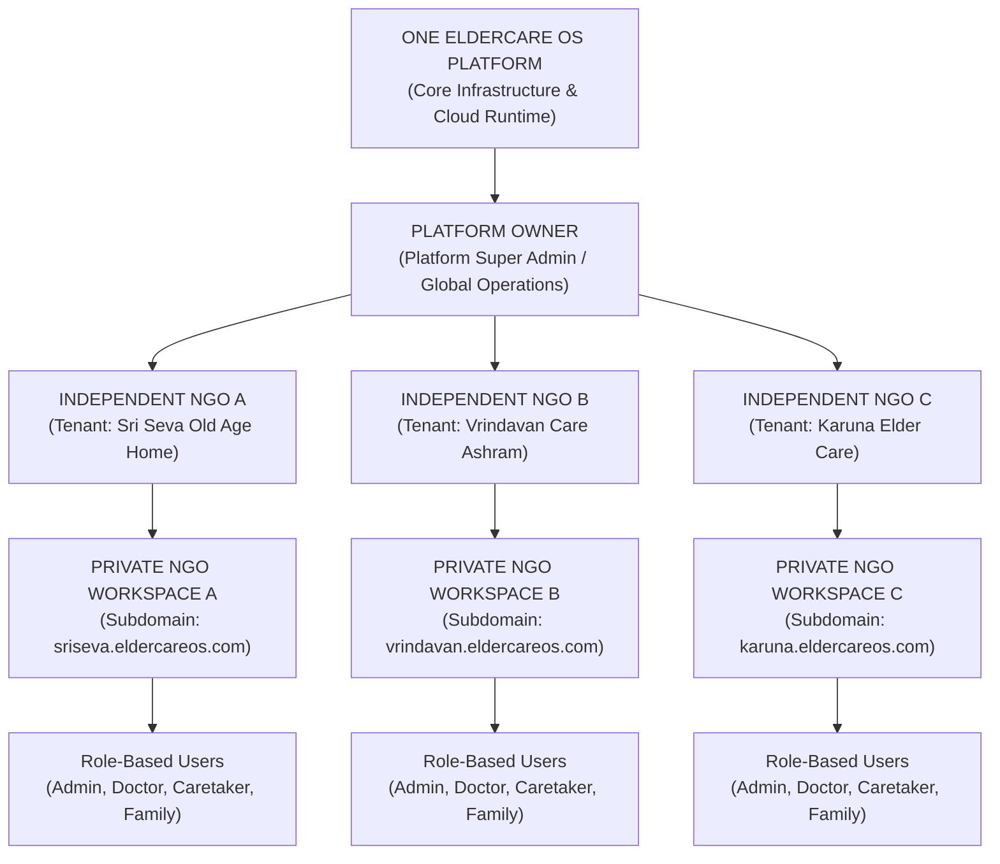
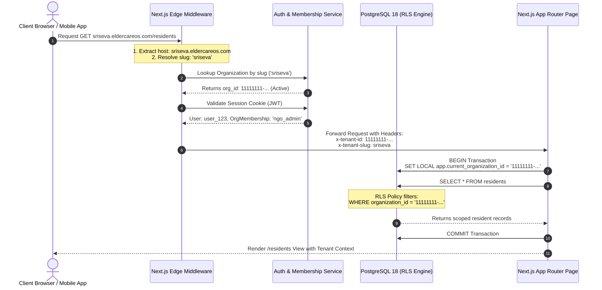
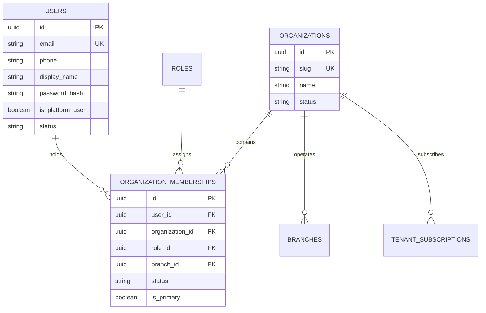
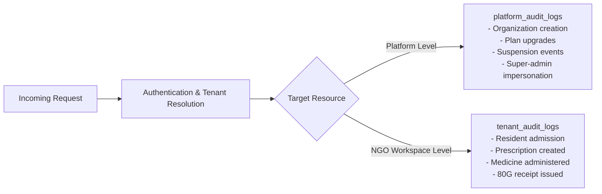

# ElderCare OS — Final Multi-Tenant SaaS Architecture

**Document Version:** 3.0.0  
**Status:** Approved Architectural Specification  
**Architect:** Principal Software Architect & Senior Database Engineer  
**Date:** 23 November 2026  

---

## 1. Executive Summary & Target Architecture

ElderCare OS is evolving from a single-organization management tool into a commercial, enterprise-grade, multi-tenant Software-as-a-Service (SaaS) platform designed for old age homes, palliative care centers, and elder-care NGOs.

### Core Architectural Hierarchy



### Architectural Tenets
1. **Zero Rebuilding:** The existing Next.js 15 App Router, React 19 UI, Tailwind CSS purple design system (`#6D28D9`, `#4C1D95`, `#FAF8FF`), 8 role dashboards, and 17 operational modules are preserved in full.
2. **Complete Tenant Isolation:** No NGO can ever read, write, or infer the existence of another NGO's residents, medical histories, financial accounts, or staff records.
3. **Engine-Level Security:** Tenancy isolation is enforced at the database engine level via PostgreSQL Row-Level Security (RLS) and transaction-scoped context, rather than relying solely on application-level `WHERE` clauses.
4. **Healthcare-First Safety:** Subscriptions and billing are strictly decoupled from patient care. Payment failures trigger grace periods and read-only modes rather than immediate operational lock-outs.

---

## 2. Multi-Tenancy Architecture & Model

### 2.1 Model Evaluation & Selection

| Tenancy Model | Data Isolation | Infrastructure Cost | Operational Complexity | Selection Decision |
| :--- | :--- | :--- | :--- | :--- |
| **Database-per-Tenant** | Physical DB per NGO | Extremely High (idle DBs, connection exhaustion) | High (schema migrations across 100+ DBs) | **Rejected** (Prohibitive for non-profit NGO SaaS budget) |
| **Schema-per-Tenant** | PostgreSQL schema per NGO | Moderate | High (complex migration scripts, search path issues) | **Rejected** (Schema explosion; difficult cross-tenant analytics for platform owner) |
| **Shared Database, Shared Schema with RLS** | Logical isolation via `organization_id` + native PostgreSQL RLS | **Optimal** (single connection pool, minimal idle cost) | **Low-Medium** (centralized migrations, engine-level security) | **APPROVED & SELECTED** |

### 2.2 Selected Model: Shared Database with Engine-Level Row-Level Security (RLS)
* Every operational table includes an immutable `organization_id UUID NOT NULL` column with a foreign key to `organizations(id)`.
* PostgreSQL Row-Level Security (RLS) is enabled on all tenant-owned tables.
* A transaction-scoped session variable (`app.current_organization_id`) is injected by the backend middleware on every database connection.
* If `app.current_organization_id` is missing, null, or invalid, all queries fail-closed (return 0 rows or throw an access violation).

---

## 3. Tenant Resolution & Routing Strategy



### 3.1 Production Tenant Resolution (Subdomain Routing)
* In production, the tenant slug is extracted from the hostname:
  * Pattern: `https://{tenant_slug}.eldercareos.com`
  * Example: `https://sriseva.eldercareos.com` resolves to `sri-seva` tenant.
  * Platform Owner Portal: `https://admin.eldercareos.com` or `https://eldercareos.com/platform-admin`.

### 3.2 Development & API Fallback Resolution
To ensure smooth local development without requiring local DNS or `/etc/hosts` hacks:
1. **Header Inspection:** `x-organization-id` or `x-tenant-slug` header.
2. **Session Context:** Active organization selected in the user's authenticated session cookie.
3. **Default Dev Fallback:** Default primary tenant (`Sri Seva Old Age Home`) used when running in local development mode.

---

## 4. Global User Identity vs. Tenant Memberships



### Core Identity Rules
1. **Single Identity, Multiple Memberships:** A user account (`users`) represents a real human identified by a verified email. A user can belong to multiple NGOs (e.g. a visiting physician who visits two different old age homes, or an auditor reviewing three facilities).
2. **Context Switching:** When a user logs in, their JWT session establishes an `active_organization_id`. They can switch between their authorized workspaces from the navigation drawer without logging out.
3. **Platform Owner Separation:** Platform Super Admins have `is_platform_user = true` on their user account. Platform privileges can never be granted through an NGO workspace role assignment.

---

## 5. Private File & Document Storage Isolation

All resident identity cards, medical prescriptions, and legal admission deeds must remain private, encrypted, and isolated by tenant.

### 5.1 Storage Hierarchy (S3 / MinIO)
```text
eldercare-vault/
└── tenants/
    ├── {organization_id}/
    │   ├── residents/
    │   │   └── {resident_id}/
    │   │       ├── aadhaar.pdf
    │   │       └── photo.jpg
    │   ├── admissions/
    │   │   └── {admission_id}/
    │   │       └── agreement_signed.pdf
    │   ├── medical/
    │   │   └── {patient_id}/
    │   │       └── prescription_nov2026.pdf
    │   └── finance/
    │       └── 80g_receipts/
    └── {another_organization_id}/
        └── ...
```

### 5.2 Storage Security Rules
1. **No Public Buckets:** The S3 bucket is completely private (`BlockPublicAcls = true`, `BlockPublicPolicy = true`).
2. **Presigned URLs with Tenant Guard:**
   * Files are downloaded exclusively via short-lived (15-minute) presigned URLs generated on the server.
   * Before issuing a presigned URL, the server verifies:
     `document.organization_id === session.active_organization_id`.
3. **Path Validation:** File keys uploaded must match `tenants/{session.organization_id}/*`. Any attempt to write outside the tenant's folder prefix is rejected by the upload authorizer.

---

## 6. Audit Logging Architecture

ElderCare OS implements dual-tier audit logging to satisfy legal accountability and clinical traceability.



* **`platform_audit_logs`:** Append-only log of cross-tenant actions, billing plan modifications, tenant provisioning, and platform admin interventions.
* **`tenant_audit_logs`:** Append-only log scoped to the NGO workspace, tracking clinical edits, vital observation entries, medication confirmations, and financial receipts.

---

## 7. High Availability, Backup, and Disaster Recovery

### 7.1 Backup Strategy
1. **Automated Continuous Archiving (WAL Archiving):** Point-In-Time Recovery (PITR) with continuous Write-Ahead Log (WAL) archiving to encrypted cold storage.
2. **Daily Logical Backups:** Daily encrypted `pg_dump` snapshots stored in a secondary cloud region.
3. **Target Metrics:**
   * **Recovery Point Objective (RPO):** $< 15$ minutes.
   * **Recovery Time Objective (RTO):** $< 2$ hours.

### 7.2 Per-Tenant Export & Portability
To ensure NGO trust and compliance with non-profit regulations:
* Any NGO Administrator can request a complete **Tenant Data Export** (JSON + zip of all tenant documents) generated by an asynchronous background worker.
