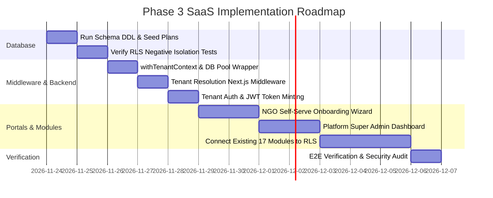

# ElderCare OS — Phase 3 Implementation Plan

**Document ID:** ECO-DOC-P3PLAN-001  
**Version:** 1.0.0  
**Status:** Approved for Review  
**Author:** Principal Software Architect & Full-Stack Lead  

---

## 1. Overview & Objectives

With the completion of **Phase 1 (Repository Discovery & Audit)** and **Phase 2 (SaaS Architecture & Database Design)**, this document sets forth the actionable, phased engineering roadmap for **Phase 3: SaaS Implementation**.

### Key Deliverables of Phase 3
1. Execute the PostgreSQL 18 Multi-Tenant Schema with native Row-Level Security (RLS).
2. Implement transaction-scoped database helpers (`withTenantContext`) in TypeScript.
3. Build Next.js Subdomain & Header Tenant Resolution Middleware.
4. Implement the Multi-Tenant NGO Onboarding Flow (`/register-ngo`).
5. Build the Platform Super Admin Portal (`/platform/*`).
6. Connect the existing 8 role dashboards and 17 operational modules to tenant-isolated backend routes.
7. Execute automated RLS cross-tenant attack tests and verify build integrity.

---

## 2. Engineering Phases & Milestones



---

## 3. Step-by-Step Implementation Sequence

### Step 3.1: Database Provisioning & Seed Execution
- **Target:** PostgreSQL 18 local instance (`localhost:5432/eldercareos`).
- **Actions:**
  1. Execute `docs/final-database-schema.md` DDL in single transaction.
  2. Verify all 26 RLS policies with `SELECT tablename, rowsecurity FROM pg_tables WHERE schemaname = 'public'`.
  3. Seed initial `subscription_plans` (Starter, Professional, Enterprise).
  4. Seed system permissions catalog (`permissions` and `role_permissions`).
  5. Run negative SQL isolation tests verifying that `SELECT * FROM residents` returns 0 rows when `app.current_organization_id` is unset.

### Step 3.2: Next.js Database Access Layer (`src/lib/db.ts`)
- **Target:** Transaction-scoped client helper for PostgreSQL.
- **Implementation Design:**
  ```typescript
  // Transaction-local RLS isolation wrapper
  export async function withTenantContext<T>(
    orgId: string,
    operation: (client: pg.PoolClient) => Promise<T>
  ): Promise<T> {
    const client = await pool.connect();
    try {
      await client.query('BEGIN');
      // Set transaction-local variable (is_local = true prevents connection poisoning)
      await client.query(`SELECT set_config('app.current_organization_id', $1, true)`, [orgId]);
      const result = await operation(client);
      await client.query('COMMIT');
      return result;
    } catch (error) {
      await client.query('ROLLBACK');
      throw error;
    } finally {
      client.release();
    }
  }
  ```

### Step 3.3: Next.js Multi-Tenant Middleware (`src/middleware.ts`)
- **Target:** Request routing and tenant domain detection.
- **Workflow:**
  1. Extract `hostname` from request headers.
  2. Determine tenant mode:
     - Root domain (`eldercareos.com`, `localhost:3000`) -> Public landing / Onboarding.
     - Platform domain (`platform.eldercareos.com`) -> Platform Owner Portal (`/platform/*`).
     - Subdomain (`sriseva.eldercareos.com`) -> Rewrite to `/[orgSlug]/*`.
  3. Validate JWT session token:
     - Verify tenant membership match (`jwt.org_id === resolvedOrg.id`).
     - Reject access if user is not a member of the requested subdomain.
  4. Check subscription state:
     - If `suspended` or `grace_period`, attach warning header for frontend banners.

### Step 3.4: Multi-Tenant NGO Onboarding Wizard (`/register-ngo`)
- **Target:** Public self-serve sign-up for new old-age homes and NGOs.
- **Screens:**
  1. **Step 1: Organization Profile** (NGO Name, Registration No, 80G status, City, Contact Person).
  2. **Step 2: Subdomain Choice** (e.g. `sriseva.eldercareos.com` with real-time uniqueness validation).
  3. **Step 3: Plan Selection** (Starter / Pro with 14-day trial, optional Razorpay checkout).
  4. **Step 4: Initial Admin Setup** (Email, Password, Mobile).
- **Backend Handler:** Invokes `provision_new_ngo_workspace(org_name, org_slug, admin_email, ...)`.

### Step 3.5: Platform Super Admin Portal (`/platform/*`)
- **Routes:**
  - `/platform/login` — Dedicated master login with MFA.
  - `/platform/dashboard` — Global MRR, active NGOs, total residents, system health.
  - `/platform/tenants` — Table of all NGOs, subscription status, resident counts, and one-click suspend/activate.
  - `/platform/subscriptions` — Plans, pricing, active subscriptions, payment webhook logs.
  - `/platform/audit-logs` — Global security log viewer.

### Step 3.6: Connecting Existing 17 Modules & 8 Dashboards
- **Target:** Wire existing mock data handlers and UI screens to authenticated `withTenantContext` API routes:
  1. Residents & Admissions (`/api/residents`, `/api/admissions`)
  2. Medical Records, Vitals, Prescriptions (`/api/medical/*`)
  3. Medication Administration & Schedules (`/api/medicines/*`)
  4. Rescue Cases (`/api/rescue/*`)
  5. Attendance & Daily Diary (`/api/attendance`, `/api/diary`)
  6. Rooms & Facilities (`/api/facilities`)
  7. Visitors (`/api/visitors`)
  8. Documents with S3 Presigned URLs (`/api/documents`)
  9. Donations & Expenses (`/api/finance/*`)
  10. Reports & Settings (`/api/reports`, `/api/settings`)

### Step 3.7: Automated Quality Gates & Testing
- **Suite 1: Static Type & Build Safety**
  - Run `pnpm lint` and `pnpm build` after every module transition.
- **Suite 2: Multi-Tenant Security & Isolation Tests**
  - Jest / Vitest integration tests querying with different `org_id` contexts.
  - Assert that Tenant B gets zero results when attempting to read Tenant A's resident or donation IDs.
- **Suite 3: Quota Violation Guard Tests**
  - Attempt admitting resident #31 on Starter tier (expect HTTP 403 `QUOTA_EXCEEDED`).
- **Suite 4: Healthcare Safety Mode Tests**
  - Set subscription to `suspended`; assert medical vitals can be read but new admission is blocked.

---

## 4. Rollback & Contingency Plan

| Scenario | Trigger | Automated / Manual Mitigation |
| :--- | :--- | :--- |
| **Database DDL Failure** | Syntax error or lock timeout during DDL run | Run is wrapped in `BEGIN ... ROLLBACK`; no partial schema changes applied. |
| **Tenant Routing Breakage** | Subdomain resolution fails on local/preview environments | Middleware falls back to `x-tenant-slug` header or session default organization. |
| **Memory / Pool Saturation** | Connection pool exhaustion under concurrent multi-tenant load | PgBouncer configured with `pool_mode = transaction` and `max_client_conn = 1000`. |
| **Payment Webhook Desync** | Razorpay webhook dropped or signature mismatch | Razorpay event polling cron worker syncs past 24 hours of events every 6 hours. |

---

## 5. Next Immediate Action

All 7 required Phase 2 architecture documents are now complete.  
The team will present the consolidated Phase 2 review to the project stakeholder and **halt for formal authorization** before commencing Phase 3 code and schema execution.
