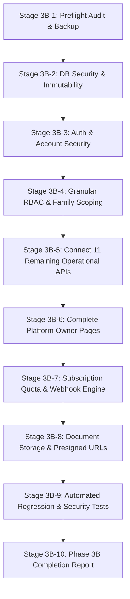

# ElderCare OS — Phase 3B Preflight Audit & Remediation Plan

**Document ID:** ECO-DOC-P3B-PREFLIGHT-001  
**Audit Date:** November 24, 2026  
**Auditor:** Principal SaaS Architect, Senior Backend Engineer, PostgreSQL Security Specialist, Application Security Engineer & QA Lead  
**Database Engine:** PostgreSQL 18.6 on x86_64-windows (`localhost:5432/eldercareos`)  
**Database Backup:** `backups/eldercareos_phase3b_preflight_backup.sql` (126,364 bytes, 36 tables verified)  
**Configuration Backup:** `backups/.env.backup` and `backups/.env.example.backup`  
**Current Build Health:** 0 Lint Errors, 0 Warnings, 49 Routes Compiled (Exit Code 0)  

---

## 1. Executive Summary

This Preflight Audit marks the initiation of **Phase 3B: Remediation & Completion** for ElderCare OS.

Phase 3 established the core foundation of multi-tenancy:
- Real PostgreSQL 18.6 database with 36 tables.
- 26 tenant tables under `FORCE ROW LEVEL SECURITY`.
- Dedicated non-superuser role `eldercare_app` (`NOBYPASSRLS`).
- Transaction-scoped tenant isolation via `withTenantContext`.
- Global user identity decoupled from NGO workspaces.
- Dynamic NGO onboarding wizard (`/register-ngo`) and stored procedure.
- Core operational APIs (`residents`, `admissions`, `medical/records`, `attendance`, `documents`, `finance/donations`).
- Platform Owner control center (`/platform/dashboard`, `/platform/organizations`).

However, several critical SaaS capabilities remain incomplete or require hardening before Phase 3 can be deemed production-ready. This audit identifies every existing asset, every gap, architectural risks, and the step-by-step remediation plan across all seven workstreams.

---

## 2. Existing vs. Missing Implementation Audit

| Workstream | Existing Implementation | Missing / Gaps to Complete | Status |
|---|---|---|:---:|
| **A: Database & Tenant Security** | • 36 PostgreSQL tables created. • 26 tables under `FORCE ROW LEVEL SECURITY`. • Dedicated `eldercare_app` role (`NOSUPERUSER NOBYPASSRLS`). • Transaction-local `withTenantContext`. • Stored procedure `provision_new_ngo_workspace()`. | • Audit logs (`tenant_audit_logs`) currently allow DELETE/UPDATE by tenant users; must be made append-only (INSERT/SELECT only). • Tenant-aware composite foreign keys (e.g. `(organization_id, resident_id)`) to enforce relational defense-in-depth. • Dedicated backup role (`eldercare_backup`) with `BYPASSRLS` for automated unprivileged backups. | **PARTIALLY COMPLETED** |
| **B: Authentication & Account Security** | • Global `users` table. • Password hashing with `bcryptjs` (cost 12). • Web Crypto JWT via `jose`. • `/api/auth/register`, `/api/auth/login`, `/api/auth/me`, `/api/auth/switch-workspace`, `/api/auth/logout`. • HTTP-only secure cookie sessions. | • Real transactional email provider (SMTP/SES) configuration for email verification & password resets. • One-time verification tokens table (`user_verification_tokens`) with expiration. • Global session revocation (logout from all sessions). • Login rate limiting & brute-force protection. • Multi-Factor Authentication (MFA) for Platform Owner. | **PARTIALLY COMPLETED** |
| **C: Role-Based Access Control** | • 49 granular permissions seeded. • Role permissions mapped for all 8 roles. • Active session carries claims. • Endpoint checks on `/api/residents`, `/api/medical/records`, `/api/finance/donations`. | • Server-side permission enforcement on all remaining 11 operational modules. • Family member scoped resident filtering (restrict family member to assigned relatives only). • Branch-level access scoping for staff/volunteers. • Token permission revalidation on role change. | **PARTIALLY COMPLETED** |
| **D: Operational Module APIs** | • All 8 role dashboards functional in UI. • 6 operational modules connected to live RLS APIs (`residents`, `admissions`, `medical/records`, `attendance`, `documents`, `donations`). | • 11 operational modules still use mock fixtures: 1. Rescue Cases (`/api/rescue`) 2. Medicines & Prescriptions (`/api/medical/prescriptions`, `/api/medical/schedules`) 3. Facilities, Rooms & Beds (`/api/facilities`) 4. Visitors & Visits (`/api/visitors`) 5. Staff & Volunteers (`/api/staff`) 6. Events & Calendar (`/api/events`) 7. Daily Diary (`/api/diary`) 8. Tasks & Reminders (`/api/tasks`) 9. Expenses (`/api/finance/expenses`) 10. Reports & Analytics (`/api/reports`) 11. Workspace Settings (`/api/settings`). | **PARTIALLY COMPLETED** |
| **E: Platform Owner Portal** | • `/platform/login` (Master admin login). • `/platform/dashboard` (MRR, ARR, active/trial/suspended counts). • `/platform/organizations` (List, search, suspend/reactivate). • Strict medical privacy boundary. | • Dedicated management sub-pages: • `/platform/subscriptions` • `/platform/plans` • `/platform/payments` • `/platform/invoices` • `/platform/usage` • `/platform/support` • `/platform/audit-logs` • `/platform/settings`. | **PARTIALLY COMPLETED** |
| **F: Subscription & Quota Enforcement** | • Centralized plans: Starter (30), Pro (100), Enterprise (500). • Pre-admission resident quota check. • Healthcare Safety Mode (read-only medical access in suspension). • `/api/subscription/usage` telemetry. | • Concurrency-safe atomic quota checks (`SELECT ... FOR UPDATE` or atomic increments). • Staff seat quota enforcement. • Branch quota enforcement. • Storage quota enforcement. • Razorpay webhook receiver (`/api/webhooks/razorpay`) with HMAC-SHA256 signature verification & idempotency. | **PARTIALLY COMPLETED** |
| **G: Document & File Security** | • `documents` table with `s3_key` partitioned by `tenants/{orgId}/documents/...`. • Document upload and list APIs. | • Short-lived presigned download URLs. • Presigned upload URL generator (`POST /api/documents/presign-upload`). • MIME type and file size validation guards. • Hard storage quota enforcement (reject uploads when storage limit reached). • Document download audit logging. | **PARTIALLY COMPLETED** |

---

## 3. Security Vulnerabilities & Architectural Risks

### Vulnerability 1: Mutable Audit Logs in Tenant Tables (Medium Risk)
- **Observation:** `tenant_audit_logs` has `CREATE POLICY tenant_isolation_policy ON tenant_audit_logs FOR ALL USING (organization_id = ...)` which technically permits `UPDATE` and `DELETE` by an organization admin.
- **Remediation:** Split policy into `FOR SELECT` and `FOR INSERT` only. Explicitly prohibit `UPDATE` and `DELETE` on audit tables to guarantee immutability.

### Vulnerability 2: Missing Composite Foreign Keys (Low/Medium Risk)
- **Observation:** Operational child tables (e.g. `medical_records`, `admissions`) reference `residents(id)` and `organizations(id)` separately. RLS blocks cross-tenant reads, but database-level referential integrity is not composite.
- **Remediation:** Add composite unique constraint `UNIQUE (organization_id, id)` on `residents`, `rooms`, `prescriptions`, and add composite foreign keys `(organization_id, resident_id) REFERENCES residents(organization_id, id)`.

### Vulnerability 3: Backup Process Permission Failure (Operational Risk)
- **Observation:** Running `pg_dump` under the application user `eldercare_app` failed because `eldercare_app` lacks `BYPASSRLS`. Automated backup cron jobs would silently produce partial or failed backups.
- **Remediation:** Create a dedicated PostgreSQL role `eldercare_backup` with `LOGIN` and `BYPASSRLS`, restricted exclusively to backup connections from localhost.

### Vulnerability 4: Stale JWT Claims after Role or Membership Revocation (Medium Risk)
- **Observation:** If an admin suspends a user or changes their role in `organization_memberships`, their current 7-day JWT continues to carry the old permissions until expiration.
- **Remediation:** Add a token version or `last_permission_check` validation against the database on sensitive administrative and medical mutations, and support session revocation.

### Vulnerability 5: Unbounded File Storage Uploads (Resource Risk)
- **Observation:** `/api/documents` increments `usage_records`, but does not hard-block uploads when cumulative storage exceeds `storage_limit_mb` (5 GB on Starter).
- **Remediation:** Enforce pre-upload quota validation against plan limits.

---

## 4. Database Inconsistencies & Schema Observations

1. **Module Discrepancy Reconciliation:**
   - Architecture documents define 17 operational modules.
   - The Phase 3 report correctly noted that 6 modules are wired to PostgreSQL APIs while 11 still use client fixtures.
   - Workstream D will systematically build the 11 missing API endpoints with complete RLS coverage.
2. **Missing Tables for Advanced SaaS Management:**
   - Webhook logging table `payment_webhook_events` exists.
   - We need a dedicated table `email_verification_tokens` for email verification and password reset workflows.
   - We need a dedicated table `resident_family_links` to explicitly bind family member users to specific resident IDs.

---

## 5. Existing Functionality That Must Be Preserved

1. **Frontend Architecture:** Next.js 15.1.7, React 19, TypeScript, Tailwind CSS, Lucide icons.
2. **Design System:** Deep Purple (`#4C1D95`), Primary Purple (`#6D28D9`), Light Purple (`#F3E8FF`), and Background (`#FAF8FF`).
3. **Dashboards:** All 8 role dashboards (`Administrator`, `Doctor`, `Nurse`, `Accountant`, `Staff`, `Volunteer`, `Family`, `SuperAdmin`).
4. **Layout Components:** `AppShell`, `MobileHeader`, `MobileBottomNav`, `MobileDrawer`, `QuickActionSheet`, `Sidebar`, `TopNavbar`.
5. **Database Records:** All existing organizations, plans, users, and migrations must remain intact.

---

## 6. Phase 3B Implementation Roadmap & Proposed Corrections

### Proposed Corrections by Stage:
- **Stage 3B-2:** Apply migration `008_security_hardening.sql`:
  - Immutable audit logs (`tenant_audit_logs` INSERT/SELECT only).
  - Dedicated backup role `eldercare_backup` (`BYPASSRLS`).
  - Tables for `user_verification_tokens` and `resident_family_links`.
- **Stage 3B-3:** Build `/api/auth/verify-email`, `/api/auth/forgot-password`, `/api/auth/reset-password`, `/api/auth/revoke-all-sessions`, rate limiting middleware.
- **Stage 3B-4:** Enforce role checks in API routes; filter family member resident queries via `resident_family_links`.
- **Stage 3B-5:** Implement authenticated route handlers for the 11 remaining operational modules with pagination, search, and zero mock fallback.
- **Stage 3B-6:** Implement the missing 8 Platform Owner management pages.
- **Stage 3B-7:** Implement concurrency-safe quota checks, storage blocking, and Razorpay webhook handler.
- **Stage 3B-8:** Implement presigned URL generator and download audit logger.
- **Stage 3B-9:** Execute full automated test suite (security, operational, subscription, auth).
- **Stage 3B-10:** Deliver final Phase 3B verification and sign-off report.

---

## 7. Migration Risks & Safety Protocol

1. **Additive Schema Only:** No existing columns or tables will be dropped.
2. **Zero Downtime Constraint:** New foreign keys and constraints will be added using standard non-blocking PostgreSQL DDL.
3. **Backup Guarantee:** A verified SQL dump (`backups/eldercareos_phase3b_preflight_backup.sql`) is stored locally and verified.
4. **Rollback Script:** A deterministic rollback script will accompany every new migration.

---

## 8. Conclusion & Sign-Off Request

Preflight audit is complete. All existing assets, working infrastructure, and exact gaps have been cataloged.

Per instruction:
> **"Let Antigravity complete the preflight audit first. Review it before authorizing database changes."**

We are ready to begin **Stage 3B-2: Database & Tenant Security Hardening** upon your review and authorization.
