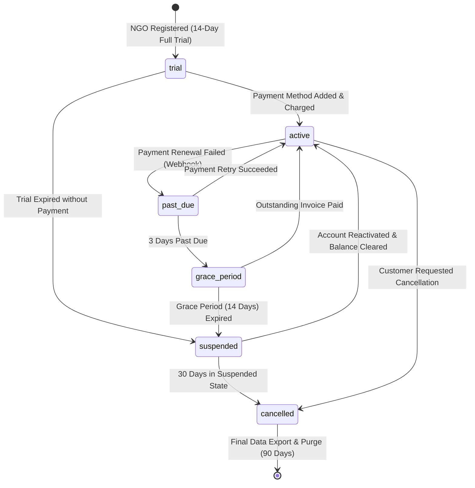
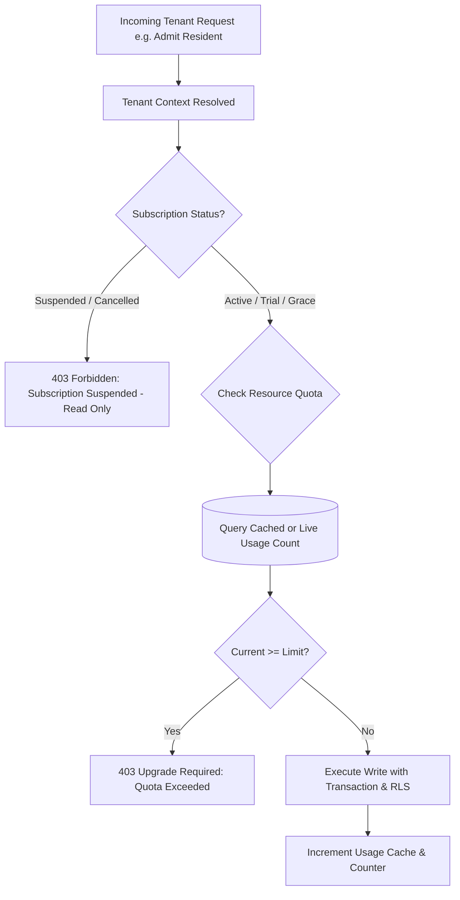
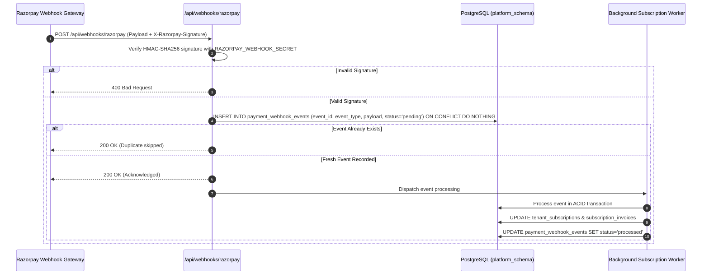

# ElderCare OS — Subscription & Billing Architecture Design

**Document ID:** ECO-DOC-BILLING-001  
**Version:** 1.0.0  
**Status:** Approved  
**Classification:** Architecture & System Design  

---

## 1. Executive Summary

ElderCare OS transitions from a single-facility system to a commercial multi-tenant SaaS platform serving independent Old Age Homes, NGOs, and Charitable Healthcare Trusts.

This document specifies:
1. **Commercial Tier Specifications & Quotas** (Starter, Professional, Enterprise).
2. **Subscription Lifecycle State Machine** with mandatory **Healthcare Safety Protocol**.
3. **Quota Enforcement Architecture** (Pre-commit checks and soft-warning thresholds).
4. **Payment Gateway Integration** (Razorpay Subscriptions, webhook idempotency, retry mechanisms).
5. **Decoupled Architecture** strictly separating SaaS Platform Billing from NGO Donation Management.

---

## 2. Commercial Pricing Tiers & Quota Specifications

Pricing is calibrated specifically for Indian and South Asian philanthropic healthcare institutions, providing transparent, predictable operating costs with an annual discount (2 months free).

| Tier Name | Target Organization | Monthly (INR) | Annual (INR) (Save 17%) | Resident Quota | Staff Seats | Branch Quota | Storage Quota | Advanced Features |
| :--- | :--- | :--- | :--- | :--- | :--- | :--- | :--- | :--- |
| **Starter** | Small hospice / single home | ₹2,999 / mo | ₹29,990 / yr | Up to 30 | Up to 5 | 1 Branch | 5 GB S3 | Core Operations, Medical Vitals, 80G Receipts |
| **Professional** | Mid-size NGO with multiple wards | ₹7,999 / mo | ₹79,990 / yr | Up to 100 | Up to 25 | Up to 3 | 25 GB S3 | All Starter + Daily Diary, Rescue Cases, Advanced Audit Logs, Custom Branding |
| **Enterprise** | Large Trust / Multi-city facility | ₹19,999 / mo | ₹1,99,990 / yr | Up to 500 | Unlimited | Unlimited | 100 GB S3 | All Pro + API Access, Custom Reports, Dedicated Account Manager, Priority SLA |

### Custom Quota Add-ons (Pro & Enterprise only)
- **Additional 50 Residents:** ₹2,500 / month
- **Additional 50 GB Storage:** ₹1,000 / month
- **Additional Branch:** ₹1,500 / month

---

## 3. Subscription Lifecycle State Machine

Healthcare facility management systems **must never abruptly block access to patient medical records or emergency medication schedules** due to credit card expiry or delayed grant disbursement.

### 3.1 State Transition Diagram



### 3.2 State Definitions & Healthcare Safety Rules

| State | Duration | Operational Capabilities | Medical & Care Capabilities | Billing Action |
| :--- | :--- | :--- | :--- | :--- |
| `trial` | 14 Days | Full feature access under Professional tier quotas. | Full access to vitals, prescriptions, medication charts. | Automated upgrade prompt on Day 7, 10, 13. |
| `active` | Recurring | Unrestricted feature access based on subscribed plan. | Unrestricted medical and caregiver capabilities. | Invoices generated automatically 3 days before renewal. |
| `past_due` | Days 1–3 | Full feature access. Banner alert to NGO Admins. | Full operational and medical access. | Razorpay Smart Collect retries on Day 1, Day 3. |
| `grace_period` | Days 4–17 (14 days) | Admin banner: *Account in Grace Period*. All reads and writes allowed. | **Full Healthcare Safety Rule:** Meds, prescriptions, vitals, and doctor visits remain 100% operational. | Automated email + SMS alerts to Organization Billing Contact. |
| `suspended` | Day 18+ (up to 30 days) | **Read-Only Mode:** Staff cannot admit residents, upload new docs, or record donations. | **Emergency Read-Only Protocol:** Doctors and nurses can READ all past records, allergies, dosages, and emergency contacts. No new edits. | Manual reconciliation link presented on login. Platform Admin notified. |
| `cancelled` | 30+ days suspended | Workspace offline. Login displays account closed state. | Facility export ZIP generated (encrypted DB dump + documents). | Data retained for 90 days for statutory healthcare audits, then securely purged. |

---

## 4. Quota Enforcement Architecture

Quotas are enforced through **Pre-Commit Application Validation** combined with atomic database count checks. This prevents race conditions and ensures tenants cannot exceed their contractual boundaries.

### 4.1 Enforcement Points



### 4.2 Protected Quota Resources
1. **`residents_limit`**: Count of active residents (`status IN ('active', 'hospital', 'leave')`). Deceased or discharged residents do not count toward active billable quota.
2. **`staff_limit`**: Count of active `organization_memberships` (`status = 'active'` and `role != 'family_member'`).
3. **`branches_limit`**: Count of rows in `branches` for the organization.
4. **`storage_limit_mb`**: Aggregate file size (`sum(file_size_bytes)`) across all documents, medical uploads, and identity proofs in S3.

### 4.3 Soft Warnings & Thresholds
- **At 80% Utilization:** UI banner on NGO Admin dashboard: *"You have used 24 of 30 resident slots (80%). Plan ahead for expansion."*
- **At 95% Utilization:** Warning modal when initiating new admission: *"Only 1 resident slot remaining. Upgrading to Pro enables 100 residents seamlessly."*
- **At 100% Utilization:** Action blocked with clear modal: *"Resident limit reached. Click here to upgrade your plan."*

---

## 5. Razorpay Integration Architecture

Payment processing for platform subscriptions is powered by **Razorpay Subscriptions (Recurring Mandates)** supporting UPI Autopay, NetBanking e-Mandates, and Credit/Debit Cards (RBI e-mandate compliant).

### 5.1 Entities Mapping

| ElderCare OS Entity | Razorpay Entity | Purpose |
| :--- | :--- | :--- |
| `organizations` | `customers` | Stores `customer_id` (`cust_xxx`), contact email, phone, and GSTIN. |
| `subscription_plans` | `plans` | Pre-created plan IDs in Razorpay (`plan_starter_m`, `plan_pro_y`, etc.). |
| `tenant_subscriptions` | `subscriptions` | Stores `subscription_id` (`sub_xxx`), auth link, billing cycle schedule. |
| `subscription_invoices` | `invoices` | Stores `invoice_id` (`inv_xxx`), line items, GST breakdown, download URL. |
| `subscription_payments` | `payments` | Stores `payment_id` (`pay_xxx`), payment method (UPI, card), transaction fee. |
| `payment_webhook_events`| Webhook payload | Raw idempotent audit log of every asynchronous payment notification. |

### 5.2 Razorpay Webhook Events & Idempotency Pipeline

To prevent double-counting or skipped state transitions, webhooks follow a strict **Verify -> Record -> Idempotent Process** cycle.



### 5.3 Handled Webhook Events

1. **`subscription.authenticated`**:
   - Customer authenticated e-mandate.
   - Status updated to `active`.
2. **`subscription.charged`**:
   - Monthly/annual recurring charge succeeded.
   - Creates a record in `subscription_invoices` (status `paid`) and `subscription_payments`.
   - Advances `current_period_end` by 30 days or 365 days.
   - Resets any `past_due` or `grace_period` flags to `active`.
3. **`subscription.pending` / `payment.failed`**:
   - Recurring charge failed (insufficient balance or expired card).
   - Updates subscription status to `past_due`.
   - Triggers notification to NGO finance contact.
4. **`subscription.halted`**:
   - Maximum retries exhausted by Razorpay.
   - Shifts status to `grace_period` (14 days safety countdown).
5. **`subscription.cancelled`**:
   - Plan cancelled; moves status to `cancelled` at the end of the current paid billing period.

---

## 6. Decoupling: Platform SaaS Billing vs. NGO Donations

A core architectural principle of ElderCare OS is the **total isolation between Platform Revenue and Tenant Philanthropic Funds**:

```
+-----------------------------------------------------------------------------------+
|                            ELDERCARE OS PLATFORM LEVEL                            |
|                                                                                   |
|  Razorpay Master Account (Platform Owner)                                         |
|  - Subscriptions: NGO -> Platform (Monthly/Annual SaaS Fee)                      |
|  - GST Invoicing: ElderCare Technologies Pvt Ltd -> NGO                           |
|  - Database: subscription_plans, tenant_subscriptions, subscription_payments      |
+-----------------------------------------------------------------------------------+
                                       |
                         STRICT ENUM & CODEBASE ISOLATION
                                       |
+-----------------------------------------------------------------------------------+
|                             NGO WORKSPACE LEVEL (TENANT)                          |
|                                                                                   |
|  Independent NGO Donation Accounts / Bank Accounts                                |
|  - Public / Donor Contributions: Public -> NGO                                    |
|  - 80G Tax Exemption Receipts: NGO -> Individual Donor                            |
|  - Database: donations, expenses, resident_sponsor_records (Tenant RLS isolated)  |
|  - Platform does NOT touch, skim, or escrow tenant philanthropic donations        |
+-----------------------------------------------------------------------------------+
```

### Statutory Compliance & Invoicing
- **Platform Invoices:** Emitted with HSN Code `998313` (Information technology software as a service) with 18% GST (CGST+SGST or IGST).
- **NGO Invoices:** NGOs receive formal B2B GST tax invoices downloadable from their Workspace Settings.

---

## 7. Verification & Implementation Checklist

- [x] Pricing tiers, resident counts, and branch allocations documented.
- [x] Healthcare Safety Protocol (14-day grace + read-only safety mode) specified.
- [x] Pre-commit quota enforcement flow defined.
- [x] Razorpay recurring subscriptions and webhook idempotency mapped.
- [x] Zero-mingling architecture between platform revenue and NGO donations enforced.
