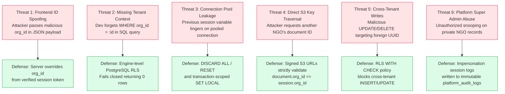
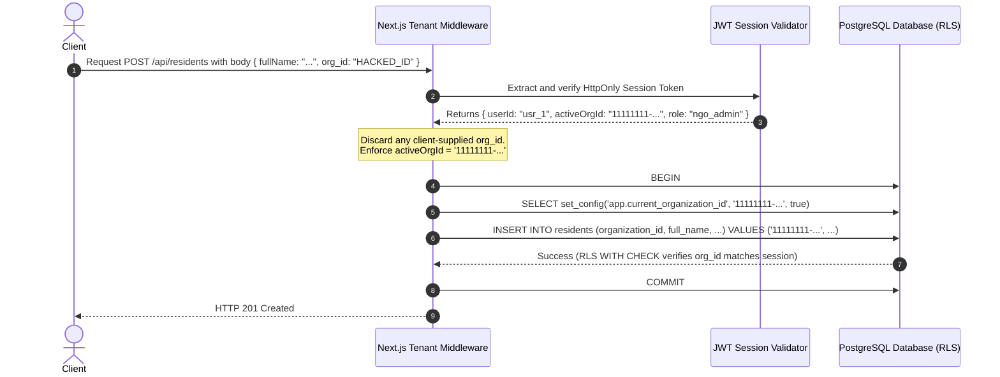

# ElderCare OS — Tenant Data Isolation & Row-Level Security (RLS) Design

**Document Version:** 3.0.0  
**Status:** Approved Security Specification  
**Architect:** Principal Software Architect & Senior Database Engineer  
**Date:** 23 November 2026  

---

## 1. Threat Modeling & Threat Vectors

In a commercial SaaS platform serving healthcare and vulnerable elderly populations, tenant isolation failure is a catastrophic vulnerability. The architecture safeguards against six specific attack vectors:



---

## 2. Server-Side Context Verification Pipeline

**Fundamental Rule:** The backend application NEVER trusts `organization_id` or `tenant_id` supplied in HTTP query parameters, request bodies, or route params.



---

## 3. Transaction-Scoped Context & Connection Pool Safety

### 3.1 The Connection Pool Poisoning Vulnerability
In Node.js applications with connection pooling (e.g. `pg`, Prisma, Drizzle, PgBouncer), connections are continuously recycled. If an application sets a session variable using `SET app.current_organization_id = 'org_A'` and returns the connection to the pool, the next request (for `org_B`) might accidentally execute within `org_A`'s context if setting the variable is omitted or fails.

### 3.2 Architectural Defense: Transaction-Local Scoping
ElderCare OS mandates **`SET LOCAL`** or `set_config(..., true)`.
* In PostgreSQL, `set_config('setting_name', 'value', is_local = true)` ensures the setting expires **automatically** upon `COMMIT` or `ROLLBACK`.
* Furthermore, on connection checkout or pool return, a clean reset is executed.

```sql
-- Pattern for every database transaction:
BEGIN;
SELECT set_config('app.current_organization_id', :tenant_uuid, true);
SELECT set_config('app.is_platform_admin', :is_super_admin, true);

-- Execute tenant queries (RLS transparently filters):
SELECT * FROM residents;

COMMIT; -- Session variables automatically vanish here!
```

---

## 4. PostgreSQL Row-Level Security (RLS) Implementation

### 4.1 Base Helper Function
```sql
-- Helper function to fetch active transaction tenant safely
CREATE OR REPLACE FUNCTION get_current_organization_id()
RETURNS UUID AS $$
BEGIN
    RETURN NULLIF(current_setting('app.current_organization_id', true), '')::UUID;
EXCEPTION
    WHEN OTHERS THEN
        RETURN NULL; -- Fail-closed if not a valid UUID
END;
$$ LANGUAGE plpgsql STABLE SECURITY DEFINER;

CREATE OR REPLACE FUNCTION is_platform_admin()
RETURNS BOOLEAN AS $$
BEGIN
    RETURN COALESCE(current_setting('app.is_platform_admin', true) = 'true', false);
END;
$$ LANGUAGE plpgsql STABLE SECURITY DEFINER;
```

### 4.2 Generic Multi-Tenant RLS Policy Pattern
For every tenant-owned table (`residents`, `rescue_cases`, `admissions`, `medical_records`, `documents`, etc.):

```sql
-- 1. Enable RLS on the table
ALTER TABLE residents ENABLE ROW LEVEL SECURITY;
ALTER TABLE residents FORCE ROW LEVEL SECURITY; -- Enforces RLS even for table owners!

-- 2. Define the Universal Tenant Isolation Policy
CREATE POLICY tenant_isolation_residents ON residents
    FOR ALL
    USING (
        -- Select, Update, Delete constraint
        (organization_id = get_current_organization_id() AND get_current_organization_id() IS NOT NULL)
        OR is_platform_admin()
    )
    WITH CHECK (
        -- Insert, Update constraint
        (organization_id = get_current_organization_id() AND get_current_organization_id() IS NOT NULL)
        OR is_platform_admin()
    );
```

### 4.3 Applying Policies Across All Operational Tables
The policy is applied across all 19 operational domain tables:
1. `branches`
2. `organization_memberships`
3. `invitations`
4. `tenant_subscriptions`
5. `subscription_invoices`
6. `subscription_payments`
7. `usage_records`
8. `residents`
9. `rescue_cases`
10. `admissions`
11. `medical_records`
12. `medical_observations`
13. `prescriptions`
14. `medication_schedules`
15. `attendance`
16. `rooms`
17. `beds`
18. `visitors`
19. `visits`
20. `documents`
21. `donations`
22. `expenses`
23. `tasks`
24. `daily_diary`
25. `events`
26. `tenant_audit_logs`

---

## 5. Automated Negative Security Test Suite

To guarantee that RLS policies cannot be broken during feature development, an automated negative test suite executes in CI/CD before any deployment.

```sql
-- ============================================================================
-- AUTOMATED TEST HARNESS: NEGATIVE SECURITY ASSERTIONS
-- ============================================================================

DO $$
DECLARE
    org_a UUID := '11111111-1111-1111-1111-111111111111';
    org_b UUID := '22222222-2222-2222-2222-222222222222';
    res_count INT;
BEGIN
    -- Setup Test Fixtures
    INSERT INTO organizations (id, slug, name, email) VALUES (org_a, 'ngo-a', 'NGO Alpha', 'a@ngo.org') ON CONFLICT DO NOTHING;
    INSERT INTO organizations (id, slug, name, email) VALUES (org_b, 'ngo-b', 'NGO Beta', 'b@ngo.org') ON CONFLICT DO NOTHING;
    
    INSERT INTO residents (id, organization_id, resident_number, full_name, gender)
    VALUES ('aaaaaaaa-aaaa-aaaa-aaaa-aaaaaaaaaaaa', org_a, 'RES-A', 'Elder Alpha', 'Male')
    ON CONFLICT DO NOTHING;

    INSERT INTO residents (id, organization_id, resident_number, full_name, gender)
    VALUES ('bbbbbbbb-bbbb-bbbb-bbbb-bbbbbbbbbbbb', org_b, 'RES-B', 'Elder Beta', 'Female')
    ON CONFLICT DO NOTHING;

    -- ------------------------------------------------------------------------
    -- TEST 1: Unset Context Must Fail Closed (Return 0 Rows)
    -- ------------------------------------------------------------------------
    PERFORM set_config('app.current_organization_id', '', true);
    PERFORM set_config('app.is_platform_admin', 'false', true);
    
    SELECT COUNT(*) INTO res_count FROM residents;
    IF res_count <> 0 THEN
        RAISE EXCEPTION 'SECURITY BREACH: Query without tenant context returned % rows (expected 0)!', res_count;
    END IF;

    -- ------------------------------------------------------------------------
    -- TEST 2: Tenant A Cannot Read Tenant B Data
    -- ------------------------------------------------------------------------
    PERFORM set_config('app.current_organization_id', org_a::TEXT, true);
    
    SELECT COUNT(*) INTO res_count FROM residents WHERE id = 'bbbbbbbb-bbbb-bbbb-bbbb-bbbbbbbbbbbb';
    IF res_count <> 0 THEN
        RAISE EXCEPTION 'SECURITY BREACH: Tenant A was able to read Tenant B resident!';
    END IF;

    -- ------------------------------------------------------------------------
    -- TEST 3: Tenant A Cannot Write into Tenant B Scoped Records
    -- ------------------------------------------------------------------------
    BEGIN
        UPDATE residents SET full_name = 'HACKED' WHERE id = 'bbbbbbbb-bbbb-bbbb-bbbb-bbbbbbbbbbbb';
        -- In RLS, UPDATE of non-visible row affects 0 rows, but let's test direct injection insert:
        INSERT INTO residents (organization_id, resident_number, full_name, gender)
        VALUES (org_b, 'HACK-RES', 'Malicious Elder', 'Male');
        
        RAISE EXCEPTION 'SECURITY BREACH: Tenant A was able to insert record into Tenant B organization_id!';
    EXCEPTION
        WHEN insufficient_privilege THEN
            NULL; -- Expected behavior! RLS WITH CHECK blocked the foreign insert.
    END;

    RAISE NOTICE 'SUCCESS: All negative security RLS isolation tests passed cleanly!';
END $$;
```
